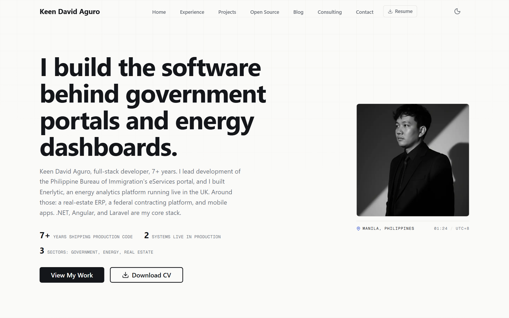

# Keen David Aguro — Portfolio

Personal portfolio and blog of Keen David Aguro, a full-stack software developer
(.NET, Angular, Laravel) based in the Philippines.

**Live:** [keendavidaguro-portfolio.vercel.app](https://keendavidaguro-portfolio.vercel.app/)



## Stack

- **Next.js 16** (App Router, Turbopack) · **React 19** · **TypeScript**
- **Tailwind CSS 4** with a custom token-based design system (light-first, opt-in dark mode)
- **Framer Motion** for scroll/entrance animation, **Lucide** icons
- **Markdown blog** — `gray-matter`, `react-markdown`, `remark-gfm`, `rehype-highlight`
- **Vercel** hosting, Analytics, and Speed Insights

## What's on the site

| Section | Source |
| --- | --- |
| Hero, core skills strip | `components/HeroSection.tsx`, `components/SkillsStrip.tsx` |
| Work experience timeline | `data/experience.ts` |
| Selected work (featured case studies + other builds) | `data/projects.ts` |
| GitHub stats and contribution graph | `app/api/github/route.ts` |
| Latest blog posts + `/blog` | `content/blog/*.md` |
| Consulting services and PHP rate ranges | `data/services.ts` |
| Contact channels | `components/ContactSection.tsx` |

## Project structure

```
app/
  layout.tsx              Fonts, SEO metadata, theme-init script, analytics
  page.tsx                Home page — composes all sections (Server Component)
  globals.css             Design tokens + hand-written .blog-prose styles
  opengraph-image.tsx     Generated Open Graph image
  sitemap.ts, robots.ts   Generated sitemap.xml / robots.txt
  api/github/route.ts     GitHub stats + contribution calendar
  blog/                   Blog index and [slug] post pages (static)
components/               One file per section + shared Button, Badge, Modal
content/blog/             Blog posts (Markdown, filename = slug)
data/                     projects.ts, experience.ts, services.ts
lib/                      blog.ts (post loading), site.ts (SITE_URL), utils.ts (cn)
services/projectService.ts  Async wrapper over data/projects.ts
public/                   Profile photo, resume.pdf, project screenshots
```

## Running locally

Requires Node.js 20+.

```bash
npm install
npm run dev      # http://localhost:3000
npm run build    # production build
npm run lint
```

### Environment variables

| Variable | Required | Purpose |
| --- | --- | --- |
| `GITHUB_PAT` | Optional | GitHub token used to fetch the contribution calendar. Without it the graph shows an honest "view on GitHub" fallback instead of data. |

Put it in `.env.local` locally and in the Vercel project settings for production.

## Writing a blog post

Add `content/blog/<slug>.md`:

```md
---
title: "Post title"
description: "One-sentence summary for the index and SEO."
date: "2026-11-17"
tags: ["dotnet", "career"]
published: true
---

Post body in Markdown…
```

Set `published: false` to keep a draft out of the index, its URL, and the sitemap.

## Updating content

- **Projects:** `data/projects.ts`. `featured: true` puts a project in the main
  case-study grid; the rest appear under "Other builds". Screenshots go in
  `public/projects/<project>/`.
- **Experience:** `data/experience.ts`.
- **Services and rates:** `data/services.ts`.
- **Resume:** replace `public/resume.pdf`.

## Notes for AI coding agents

Design-system rules and content conventions live in [`AGENTS.md`](AGENTS.md)
(mirrored in `.github/copilot-instructions.md`).

## License

[MIT](LICENSE)
